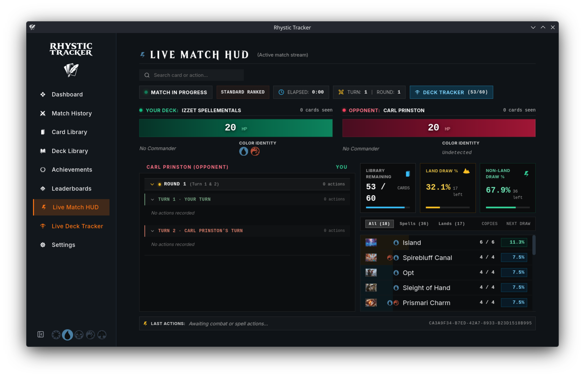
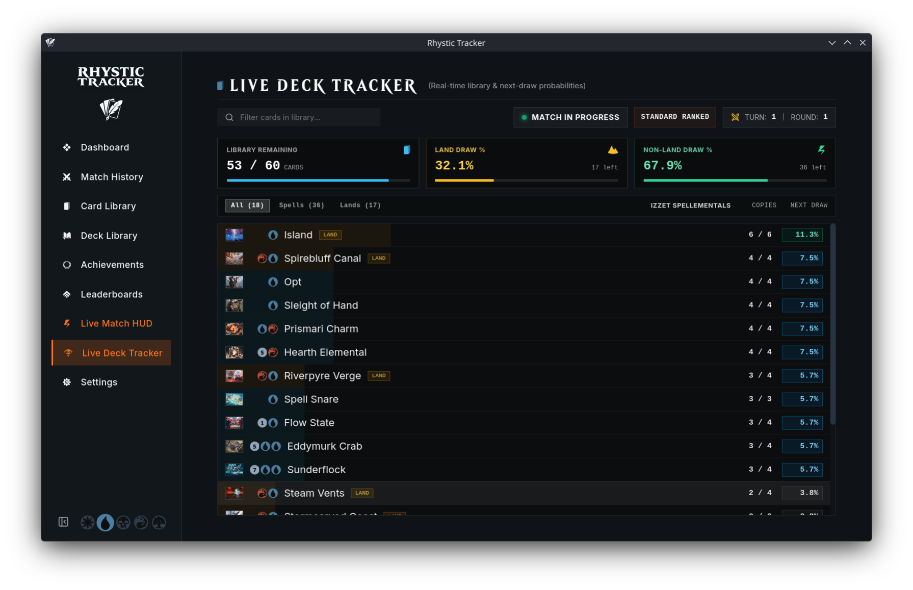
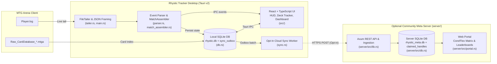

```markdown
<p align="center">
  
</p>

<p align="center">
  <strong>Open-source, local-first MTG Arena companion, live deck tracker, collection analyzer, and self-hostable community meta platform for Linux, macOS, and Windows.</strong>
</p>

<p align="center">
  
  
  
  
  <a href="LICENSE"></a>
</p>

<p align="center">
  <a href="docs/USER_GUIDE.md"><strong>User Guide</strong></a> &nbsp;&bull;&nbsp;
  <a href="docs/PLATFORM_ROADMAP.md"><strong>Platform Roadmap</strong></a> &nbsp;&bull;&nbsp;
  <a href="CHANGELOG.md"><strong>Changelog</strong></a>
</p>

---

## Overview

**Rhystic Tracker (v2.0.0)** is a local-first desktop companion and combat analytics engine for *Magic: The Gathering Arena*, paired with an optional self-hostable community meta server and web portal. Built with **Tauri v2 (Rust)**, **React (TypeScript)**, and **SQLite**, it tails MTGA's `Player.log` in real time to record matches, London mulligans, card draws, spell resolutions, zone transfers, combat damage, economy transactions, and collection updates on your local machine—with no mandatory cloud accounts or telemetry.

> [!NOTE]
> **Fork Attribution (MIT License)**  
> This repository is an extended fork of [Balthazzahr/Rhystic-Tracker](https://github.com/Balthazzahr/Rhystic-Tracker), originally created by [Balthazzahr](https://github.com/Balthazzahr) under the [MIT License](LICENSE).  
> **v2.0.0 Fork Maintainer:** [@Matt4C6F656872](https://github.com/Matt4C6F656872) — adds the Live Deck Tracker, Split-HUD overlay, customizable Bento dashboard, activated Deck Honors, Core engine & Best-of-3 hardening, Opt-In 3-Tier Cloud Sync, and the standalone Rust/Axum Community Meta Server & Web Portal.

---

## Interface Overview

| Dashboard (Bento Grid) | Match History |
| :---: | :---: |
|  |  |
| **Live Match HUD (with Split Deck Tracker)** | **Live Deck Tracker** |
|  |  |
| **Match Inspector (Timeline Replay)** | **3-Panel Card Inspector** |
|  |  |

<details>
<summary><strong>View Additional Screenshots (Decks, Collection, Achievements & Leaderboards)</strong></summary>
<br />

| Deck Library (Card View) | Deck Library (Table View) |
| :---: | :---: |
|  |  |
| **Card Library (Card View)** | **Card Library (Table View)** |
|  |  |
| **Global Achievements & Trophies** | **Achievement Details Roster** |
|  |  |
| **All-Time Leaderboards & Podium** | **Leaderboard 25-Card Drilldown** |
|  |  |

</details>

---

## Core Features

### 1. Live Match HUD & Live Deck Tracker Overlays
- **Always-on-Top Live Match HUD:** Displays Hero and Opponent commanders, dynamic life bars scaled by format (`40` for Commander, `25` for Brawl, `20` for Constructed/Limited) with animated damage/heal transition bars, collapsible round-by-round combat and spell damage feeds, token creations, and zone transfers.
- **Live Deck Tracker (Standalone & Embedded Split-HUD):** Tracks your active library in real time as cards move between Library, Hand, Battlefield, Graveyard, Exile, and Command Zone:
  - **Top 3-Metric Summary Bar:** Displays **Library Remaining** (`remaining / initial`), **Land Draw %**, and **Non-Land Draw %** with live progress bars.
  - **Probability-Sorted Card List & Filters:** Quick filter pills (`All`, `Spells`, `Lands`), live search, Scryfall art thumbnails, hover card previews, `Copies` (`remaining / initial`), and color-coded `Next Draw %` badges. Depleted cards (`0 / N`) automatically dim and sink to the bottom.
  - **Embedded HUD Split View:** Toggle the **Deck Tracker** panel directly inside the **Live Match HUD** to view the live combat feed and remaining library probabilities side by side, or use the dedicated **Live Deck Tracker** sidebar tab.
- **Best-of-3 Match Transitions:** Preserves match-wide card and turn accumulators across Games 1, 2, and 3 while resetting per-game battlefield instance maps, library counts, and life totals between games.

### 2. Match Analytics & Achievements
- **Turn-by-Turn Match Timelines:** Full London mulligan detection, opening hand inspection (`mulligan` and `bottom` badges), and chronological turn replay of land drops, spell casts, ability activations, life swings, and combat hits.
- **Commander & Brawl Tracking:** Automatic detection and pairing of Hero and Opponent Commanders (including partner/background zones), Commander tax tracking, and multi-card match history filtering.
- **21 Custom SVG Card Trophies & Deck Honors:**
  - **Card Trophies:** Multi-tier badges (Iron through Legendary) across 7 combat categories including *Executioner*, *Overkiller*, *Board Wiper*, *Card Draw Engine*, *Negator*, and *Scoop Inducer*.
  - **Deck Honors:** Automated evaluation and historical backfill of deck-level achievements (*On a Roll*, *Comeback Kid*, *Gotta Go Fast*, *Iron Fortress*, *Marathon Master*, and *Deck Dominance*), scaled dynamically by format starting life.

### 3. Bento Dashboard, Economy & Collection
- **Customizable Bento Dashboard:** Modular widget grid featuring Win-Rate Time Series, Format Distribution, Commander Spotlight, Mana Curve & Speed Clocks, Play vs. Draw Splits, Mulligan Analytics, Nemesis & Victim Tracker, and Lucky/Cursed Cards.
- **Economy, Quests & Mastery:** Tracks Gold, Gems, Vault Progress, Wildcard inventory, daily quest completion and reroll history, and set Mastery Pass progression.
- **Collection Analyzer:** Indexes MTGA's local `Raw_CardDatabase_*.mtga` (26,000+ cards in ~150ms) with set completion progress bars, 4-copy ownership indicators, and custom per-card art preferences.

### 4. Community Meta Server & Web Portal (`server/`)
- **Opt-In 3-Tier Privacy Cloud Sync:** Offline by default (`Tier 0`), with granular controls in **Settings → Connections & Cloud Sync** for anonymous match telemetry (`Tier 1`), full decklists for archetype clustering (`Tier 2`), and public leaderboard attribution (`Tier 3`).
- **First-Seen Handle Claiming & Token Recovery:** Binds each Arena handle and `player_account_hash` to the SHA-256 digest of the owner's secret local `contributor_id` token on first sync, preventing handle spoofing via local `Player.log` edits. Includes 1-click token copy/restore in Settings for cross-device migration.
- **Core vs. Flex-Slot Matrix:** 4-layer aggregation pipeline (Exact `deck_hash`, Commander grouping, TF-IDF Weighted Jaccard 60-card clustering, and 17Lands-style Limited color pairs) comparing **Core Cards (≥ 70% inclusion)** against **Flex Slots (< 70% inclusion)** with win-rate delta bars.
- **Web Portal UI:** Features Scryfall `art_crop` blurred headers, floating card hover previews, `mana-font` WUBRG pips, `keyrune` set icons, and 1-click MTGA clipboard deck export.

---

## Architecture



| Layer | Directory | Responsibilities |
| --- | --- | --- |
| **Desktop Rust Core** | `src-tauri/src/` | Real-time `Player.log` tailing (`tailer.rs`), string-aware JSON stream framing (`main.rs`), GRE state & achievement engine (`parser.rs`, `match_assembler.rs`, `deck_achievements.rs`), local SQLite persistence (`db.rs`), card indexing (`card_db.rs`), Tauri IPC handlers (`commands/`), and opt-in sync outbox (`sync.rs`). |
| **Desktop React UI** | `src/` | Interface views (`App.tsx`, `LiveHUDView.tsx`, `LiveDeckTrackerView.tsx`, `DashboardView.tsx`, `MatchHistoryView.tsx`, `DeckDetailView.tsx`, `CollectionView.tsx`, `AchievementsView.tsx`, `LeaderboardsView.tsx`, `SettingsView.tsx`). |
| **Community Meta Server** | `server/src/` | Self-hostable Rust (`axum` + `sqlx`) ingestion and analytics server (`main.rs`, `lib.rs`), analytical SQLite schema with `match_hash` deduplication and handle pinning (`db.rs`), and the Community Web Portal (`portal.rs`). |

---

## Installation & Build Instructions

### 1. Prebuilt Packages

Builds created with `npm run tauri build` generate packages for:

* **Linux:** `.deb`, `.rpm`, `.AppImage`, and Arch Linux AUR (`packaging/aur/`).
* **macOS:** Universal `.dmg` / `.app`.
* **Windows:** `.exe` (NSIS) and `.msi`.

> **Linux Runtime Note:** Requires `webkit2gtk-4.1` and `libappindicator-gtk3` (or `libayatana-appindicator3-1`). On Wayland / Steam Deck, the desktop launcher automatically applies `GDK_BACKEND=x11 WEBKIT_DISABLE_COMPOSITING_MODE=1`.

### 2. Linux / Bazzite / Distrobox Automated Script

On Linux—including immutable distributions like **Bazzite** and **Fedora Silverblue** where build headers live inside a `distrobox` container—run:

```bash
# Build (via distrobox 'fedora-dev' if needed), install to ~/.local/bin, and launch:
./scripts/install-linux.sh

# Build and install without launching:
./scripts/install-linux.sh --no-run
```

### 3. Building Manually from Source

Requires **Node.js (v18+)** and **Rust (stable)**.

* **Debian / Ubuntu / Linux Mint / Pop!_OS:**
  ```bash
  sudo apt update && sudo apt install -y libwebkit2gtk-4.1-dev libgtk-3-dev libayatana-appindicator3-dev librsvg2-dev build-essential curl wget file libssl-dev libjavascriptcoregtk-4.1-dev nodejs npm
  ```
* **Fedora / RHEL:**
  ```bash
  sudo dnf install -y webkit2gtk4.1-devel gtk3-devel libappindicator-gtk3-devel librsvg2-devel openssl-devel @development-tools nodejs npm
  ```
* **Arch Linux / CachyOS / Manjaro:**
  ```bash
  sudo pacman -S --needed webkit2gtk-4.1 base-devel curl wget openssl appmenu-gtk-module libappindicator-gtk3 librsvg nodejs npm
  ```

```bash
npm install
npm run tauri dev     # Development mode with hot-reload
npm run tauri build   # Production installer bundles (.deb, .rpm, .dmg, .exe)
```

### 4. Running the Optional Community Server (`server/`)

To self-host the Community Meta Server and Web Portal locally or on a VPS:

```bash
cd server
cargo run --release

```

Customize the listen address and SQLite database path via environment variables:

```bash
RHYSTIC_SERVER_ADDR="127.0.0.1:8080" \
RHYSTIC_SERVER_DB="/var/lib/rhystic/rhystic_meta.db" \
cargo run --release

---

## License & Legal

Licensed under the **[MIT License](LICENSE)**.

```text
Copyright (c) 2026 Balthazzahr (https://github.com/Balthazzahr)
Copyright (c) 2026 Matt4C6F656872 (https://github.com/Matt4C6F656872) (Fork modifications and additions)
```

**Fan Content Disclaimer:** Rhystic Tracker is unofficial Fan Content permitted under the Wizards of the Coast Fan Content Policy. Portions of the materials used are property of Wizards of the Coast. © Wizards of the Coast LLC. Card artwork and symbols are fetched via Scryfall's API.
