<p align="center">
  
</p>

<p align="center">
  <strong>The open-source, local-first MTG Arena companion, live deck tracker, collection & economy analyzer, and self-hostable community meta platform for Linux, macOS & Windows.</strong>
</p>

<p align="center">
  
  
  
  
  <a href="LICENSE"></a>
</p>

<p align="center">
  <a href="docs/USER_GUIDE.md"><strong>📖 User Guide & Manual</strong></a> &nbsp;•&nbsp;
  <a href="docs/PLATFORM_ROADMAP.md"><strong>🗺️ Platform & Cloud Roadmap</strong></a> &nbsp;•&nbsp;
  <a href="CHANGELOG.md"><strong>📝 Release Changelog</strong></a>
</p>

---

## ⚡ Project Overview & Fork Attribution

**Rhystic Tracker (v2.0.0)** is a native, local-first desktop companion and combat analytics engine for *Magic: The Gathering Arena*, coupled with an optional self-hostable community meta server and web portal. Built with **Tauri v2 (Rust)**, **React (TypeScript)**, and **SQLite**, it tails MTGA's `Player.log` in real time to record every match, London mulligan, card draw, spell resolution, zone transfer, combat swing, economy transaction, and collection update on your local machine—with zero mandatory cloud accounts or telemetry.

> [!IMPORTANT]
> ### Fork Attribution & Upstream Credit (MIT License)
> This repository is an extended fork of [**Rhystic Tracker**](https://github.com/Balthazzahr/Rhystic-Tracker), originally created by [**Balthazzahr**](https://github.com/Balthazzahr) and distributed under the [MIT License](LICENSE).
>
> - **Original Author & Upstream Repository:** Copyright (c) 2026 [Balthazzahr](https://github.com/Balthazzahr) — [`github.com/Balthazzahr/Rhystic-Tracker`](https://github.com/Balthazzahr/Rhystic-Tracker)
> - **Fork Maintainer & Additions:** Copyright (c) 2026 **Matthias Löhr** (GitHub: [`@Matt4C6F656872`](https://github.com/Matt4C6F656872))
>
> #### What This Fork Adds & Expands (v2.0.0):
> 1. **Live Deck Tracker & Split-HUD Overlay:** Real-time draw probabilities, remaining library counts, graveyard/exile/command zone tracking, embedded HUD + Deck split view, and Best-of-3 multi-game state handling.
> 2. **Community Meta Server & Web Portal (`server/`):** A standalone Rust + Axum analytical server and glassmorphic web portal featuring a 4-layer archetype clustering engine, **Core vs. Flex-Slot Matrix**, **Scryfall Art Headers & Card Hover Previews**, **1-Click MTGA Deck Export**, and **First-Seen Handle Pinning (`claimed_handles`)** with cross-device contributor token recovery.
> 3. **Opt-In 3-Tier Cloud Sync (`src-tauri/src/sync.rs`):** Local SQLite outbox queue (`sync_outbox`) with granular privacy controls under **Settings → Connections & Cloud Sync**.
> 4. **Customizable Bento Dashboard, Economy & Collection Analytics:** Draggable/toggleable dashboard widgets, Gold/Gems/Wildcard/Vault history, Quest & Mastery tracking, and set completion breakdowns.
> 5. **Activated Deck Honors & Format-Scaled Achievements:** Full activation of Deck Achievements (`On a Roll`, `Comeback Kid`, `Gotta Go Fast`, `Iron Fortress`, `Marathon Master`, `Deck Dominance`) scaled dynamically for 20-life Constructed, 25-life Brawl, and 40-life Commander games.
> 6. **Core Engine Hardening & Immutable Linux Support:** String-aware JSON log framing, log rotation recovery, Bo3 state isolation, N+1 SQL query elimination, and automated Distrobox builds for Bazzite / Fedora Silverblue (`./scripts/install-linux.sh`).

> **Fan Content Disclaimer:** Rhystic Tracker is unofficial Fan Content permitted under the Wizards of the Coast Fan Content Policy. Portions of the materials used are property of Wizards of the Coast. © Wizards of the Coast LLC. Card artwork and symbols are fetched via Scryfall's API.

---

## ✨ Current Feature Breakdown

### 1. Live Overlays (`Live Match HUD` & `Live Deck Tracker`)
- **Always-on-Top Live Match HUD:** Real-time game state tracker displaying Hero and Opponent commanders, dynamic life bars scaled automatically by format (`40` for Commander, `25` for Brawl, `20` for standard Constructed/Limited), turn-by-turn combat & spell damage attributions, token creations, and zone transfers.
- **Live Deck Tracker & Embedded Split View:** Tracks your active deck in real time as cards move between Library, Hand, Battlefield, Graveyard, Exile, and Command Zone—calculating live draw percentages ($1+$, land, and per-card probabilities). Can be used as a dedicated tab or toggled directly inside the Live Match HUD split panel.
- **Best-of-3 (Traditional) Match Transitions:** Preserves match-wide card/turn accumulators across Games 1, 2, and 3 while cleanly resetting per-game battlefield instance maps and life totals between games.
- **Configurable Match-Start Auto-Switch:** Automatically switch to `Live Match HUD`, `Live Deck Tracker`, or stay on your current workspace when a match begins.

### 2. Deep Match Analytics & Achievements
- **Turn-by-Turn Match Timelines:** Full London mulligan detection, opening hand inspection (`mulligan` and `bottom` badges), and chronological turn replay of every land drop, spell cast, ability activation, life swing, and combat hit.
- **First-Class Commander & Brawl Tracking:** Automatic detection and pairing of Hero and Opponent Commanders (including partner/background zones), Commander tax tracking, and multi-commander/multi-card match history filtering.
- **Per-Card Performance Awards (`ImpactfulCardTracker`) & Deck Honors:**
  - **21 Custom SVG Card Trophies** across 7 combat categories (Iron, Bronze, Silver, Gold, Titanium/Platinum, and Legendary tiers) such as *Executioner*, *Overkiller*, *Board Wiper*, *Card Draw Engine*, *Negator*, and *Scoop Inducer*.
  - **Deck Honors:** Automated evaluation and historical backfill of deck-level achievements (*On a Roll*, *Comeback Kid*, *Gotta Go Fast*, *Iron Fortress*, *Marathon Master*, and *Deck Dominance*).
  - **All-Time Leaderboards & Hall of Fame:** 3×3 domain grid with podium crowns and 25-card drill-down modals.

### 3. Dashboard, Economy & Collection
- **Customizable Bento Dashboard:** Modular widget grid featuring Win-Rate Time Series (`Today`, `7 Days`, `30 Days`, `12 Months`, `All Time`), Format Distribution, Commander Spotlight, Mana Curve & Speed Clocks, Play vs. Draw Splits, Mulligan Analytics, Nemesis & Victim Tracker, and Lucky/Cursed Cards.
- **Economy, Quests & Mastery Tracking:** Tracks Gold, Gems, Vault Progress, Wildcard inventory (Common, Uncommon, Rare, Mythic), daily quest completion history, and set Mastery Pass progression.
- **Collection Analyzer & Set Completion:** Visual 4×3 card library and table explorer synced with MTGA's local `Raw_CardDatabase_*.mtga` (26,000+ cards indexed in ~150ms), featuring set completion progress bars, 4-diamond ownership controls, and persistent per-card custom set/art preferences.

### 4. Community Meta & Self-Hostable Web Portal (`server/`)
- **Opt-In 3-Tier Privacy Cloud Sync:** Configured in **Settings → Connections & Cloud Sync**. Strictly offline by default (`Tier 0`), with granular checkboxes for anonymous match outcomes & card telemetry (`Tier 1`), full decklists for archetype clustering (`Tier 2`), and public leaderboard handle attribution (`Tier 3`).
- **First-Seen Handle Claiming (`claimed_handles`) & Token Recovery:** When an Arena handle is synced for the first time, the server binds the normalized handle and `player_account_hash` to the SHA-256 digest of the user's secret local `contributor_id` token—preventing stream-snipers or `Player.log` editors from spoofing another player's handle. Users can copy and restore their secret contributor token across devices directly in the UI.
- **Unified Archetype & Core vs. Flex-Slot Matrix:** 4-layer aggregation pipeline (Exact `deck_hash`, Commander grouping, TF-IDF Weighted Jaccard 60-card archetype clustering, and 17Lands-style Limited color-pair analytics) with side-by-side **Core ($\ge 70\%$)** vs. **Flex ($< 70\%$)** inclusion win-rate delta tables and an in-place **Variant Switcher**.
- **Scryfall Art Headers, Hover Previews & 1-Click MTGA Export:** Zero-blocking Scryfall `art_crop` blurred banners for Commanders and Archetypes, interactive floating `normal` card image previews on hover, visual win-rate bars, real `mana-font` WUBRG pips, and 1-click MTGA clipboard deck export.

---

## 📸 Screenshots Showcase

|                  Dashboard (Bento Grid)                   |                  Match History                   |
| :-------------------------------------------------------: | :----------------------------------------------: |
|                |       |

|                    Live Match HUD                         |                Live Deck Tracker                 |
| :-------------------------------------------------------: | :----------------------------------------------: |
|       |  |

|             Match Inspector (Timeline Replay)             |                  3-Panel Card Inspector          |
| :-------------------------------------------------------: | :----------------------------------------------: |
|  |  |

|                 Deck Library (Card View)                  |            Deck Library (Table View)             |
| :-------------------------------------------------------: | :----------------------------------------------: |
|       |  |

|                 Card Library (Card View)                  |            Card Library (Table View)             |
| :-------------------------------------------------------: | :----------------------------------------------: |
|       |  |

|            Global Achievements & Trophies                 |                 Achievement Details Roster       |
| :-------------------------------------------------------: | :----------------------------------------------: |
|          |  |

|            All-Time Leaderboards & Podium                 |                 Leaderboard 25-Card Drilldown    |
| :-------------------------------------------------------: | :----------------------------------------------: |
|          |  |

---

## 🏗️ Architecture Summary

```mermaid
flowchart LR
    subgraph MTGA["MTG Arena Client"]
        LOG["Player.log"]
        RAW["Raw_CardDatabase_*.mtga"]
    end

    subgraph Desktop["Rhystic Tracker Desktop (Tauri v2)"]
        TAILER["FileTailer & String-Aware JSON Framing\n(src-tauri/src/tailer.rs, main.rs)"]
        PARSER["Event Parser & MatchAssembler\n(parser.rs, match_assembler.rs)"]
        SQLITE[("Local SQLite DB\nrhystic.db + sync_outbox\n(src-tauri/src/db.rs)")]
        SYNC["Opt-In Cloud Sync Worker\n(src-tauri/src/sync.rs)"]
        UI["React + TypeScript Frontend\nLive HUD, Deck Tracker, Bento Dashboard\n(src/)"]
    end

    subgraph Cloud["Optional Community Meta Server (server/)"]
        AXUM["Axum REST API & Ingestion\n(server/src/lib.rs)"]
        META_DB[("Server SQLite DB\nrhystic_meta.db + claimed_handles\n(server/src/db.rs)")]
        PORTAL["Glassmorphic Web Portal\nCore/Flex Matrix & Leaderboards\n(server/src/portal.rs)"]
    end

    LOG -->|"16MB lookback + live tail"| TAILER
    RAW -->|"Startup card index"| SQLITE
    TAILER --> PARSER
    PARSER -->|"Real-time IPC events"| UI
    PARSER -->|"Matches, Decks, Economy, Trophies"| SQLITE
    SQLITE <-->|"Tauri IPC Commands"| UI
    SQLITE -->|"Batched outbox"| SYNC
    SYNC -.->|"HTTPS POST /api/v1/sync/matches\n(Opt-in Only)"| AXUM
    AXUM --> META_DB
    META_DB --> PORTAL
```



| Layer | Directory | Responsibilities |
| :--- | :--- | :--- |
| **Desktop Rust Core** | `src-tauri/src/` | Real-time `Player.log` tailing (`tailer.rs`), string-aware JSON stream framing (`main.rs`), GRE state & combat achievement engine (`parser.rs`, `match_assembler.rs`, `deck_achievements.rs`), local SQLite persistence (`db.rs`), Scryfall/MTGA card database indexing (`card_db.rs`), Tauri IPC commands (`commands/`), and opt-in sync outbox (`sync.rs`). |
| **Desktop React UI** | `src/` | WUBRG color-identity themed glassmorphic interface (`App.tsx`), `LiveHUDView.tsx`, `LiveDeckView.tsx`, customizable Bento `DashboardView.tsx` (`components/dashboard/widgets/`), `MatchHistoryView.tsx`, `DeckLibraryView.tsx`, `CardLibraryView.tsx`, `AchievementsView.tsx`, `LeaderboardsView.tsx`, and `SettingsView.tsx`. |
| **Community Meta Server** | `server/src/` | Self-hostable Rust (`axum` + `sqlx`) ingestion & analytics server (`main.rs`, `lib.rs`), analytical SQLite schema with idempotent `match_hash` deduplication and First-Seen Handle Pinning (`db.rs`), and the SSR/SPA Community Web Portal (`portal.rs`). |

---

## 🚀 Installation & Build Instructions

### 1. Prebuilt Packages & Releases
Prebuilt bundles generated via `tauri build` target:
- **Linux:** `.deb` (Debian/Ubuntu/Pop!\_OS), `.rpm` (Fedora/RHEL/openSUSE), AppImage / `.tar.gz`, and Arch Linux AUR (`packaging/aur/`).
- **macOS:** Universal `.dmg` / `.app` bundle.
- **Windows:** `.exe` (NSIS installer) and `.msi`.

> **Runtime Dependencies (Linux):** Ensure `webkit2gtk-4.1` and `libappindicator-gtk3` (or `libayatana-appindicator3-1` on Debian/Ubuntu) are installed on your host system.
> **Wayland / Steam Deck Note:** Rhystic Tracker runs with `GDK_BACKEND=x11 WEBKIT_DISABLE_COMPOSITING_MODE=1` (configured automatically by the installer desktop entry).

---

### 2. Building from Source (Linux, macOS, Windows)

#### System Prerequisites
- **Node.js** (v18+) & **npm**
- **Rust Toolchain** (`rustup`, stable)
- **Platform WebView & GTK3 Development Headers (Linux only):**
  - **Debian / Ubuntu / Linux Mint / Pop!\_OS:**
    ```bash
    sudo apt update
    sudo apt install -y libwebkit2gtk-4.1-dev libgtk-3-dev libayatana-appindicator3-dev librsvg2-dev build-essential curl wget file libssl-dev libjavascriptcoregtk-4.1-dev nodejs npm
    ```
  - **Fedora / RHEL:**
    ```bash
    sudo dnf install -y webkit2gtk4.1-devel gtk3-devel libappindicator-gtk3-devel librsvg2-devel openssl-devel @development-tools nodejs npm
    ```
  - **Arch Linux / CachyOS / Manjaro:**
    ```bash
    sudo pacman -S --needed webkit2gtk-4.1 base-devel curl wget openssl appmenu-gtk-module libappindicator-gtk3 librsvg nodejs npm
    ```

#### Standard Development & Production Build
```bash
# 1. Install frontend dependencies
npm install

# 2. Run in development mode with hot-reload
npm run tauri dev

# 3. Build a standalone release binary (no OS installer bundle)
npm run build:app

# 4. Or build full platform installer bundles (.deb, .rpm, .dmg, .exe)
npm run tauri build
```

---

### 3. Linux / Bazzite / Distrobox Helper Workflow (`./scripts/install-linux.sh`)

For Linux desktops—including immutable distributions like **Bazzite** and **Fedora Silverblue** where `webkit2gtk4.1-devel` lives inside a `distrobox` container rather than on the host—use [`scripts/install-linux.sh`](scripts/install-linux.sh):

```bash
# Build (automatically entering distrobox 'fedora-dev' if needed),
# install to ~/.local/bin/rhystic-tracker, register icons + .desktop launcher, and launch:
./scripts/install-linux.sh

# Build and install without launching:
./scripts/install-linux.sh --no-run

# Install the existing release binary and launch without rebuilding:
./scripts/install-linux.sh --no-build

# Override the Distrobox container name (defaults to 'fedora-dev'):
RHYSTIC_DISTROBOX=my-dev-box ./scripts/install-linux.sh
```

---

### 4. Running the Optional Axum Community Server (`server/`)

You can self-host the Rhystic Community Meta & Web Portal locally or on a VPS:

```bash
cd server
cargo run --release
```

By default, the server listens on `http://0.0.0.0:8080` and creates its analytical SQLite database at `./rhystic_meta.db`. You can customize both via environment variables:

```bash
RHYSTIC_SERVER_ADDR="127.0.0.1:8080" \
RHYSTIC_SERVER_DB="/var/lib/rhystic/rhystic_meta.db" \
cargo run --release
```

- **Web Portal UI:** Open `http://localhost:8080/` in your browser.
- **Desktop Client Sync:** In the desktop app, open **Settings → Connections & Cloud Sync**, set the Server URL to `http://localhost:8080`, enable Community Meta Sync, and click **Sync Historical Matches**.

---

## 📄 License & Copyright

This project is licensed under the **[MIT License](LICENSE)**.

```text
Copyright (c) 2026 Balthazzahr (https://github.com/Balthazzahr)
Copyright (c) 2026 Matthias Löhr / GitHub Handle: Matt4C6F656872 (Fork modifications and additions)
```

See [LICENSE](LICENSE) for the full license text and permission notice.
