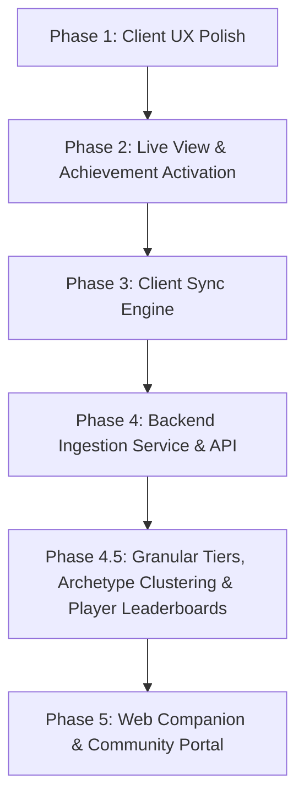

# Rhystic Cloud & Platform Vision & Roadmap

This document outlines the architectural strategy, vision, and roadmap for evolving Rhystic Tracker from a local-first desktop tracker into an open, community-driven analytics platform with an optional opt-in central server (inspired by platforms like Untapped.gg and 17lands).

---

## 1. Legal, Licensing & Values

- **License:** Licensed under the [MIT License](file:///home/matt/Code/Rhystic-Tracker-1.7.8/LICENSE). Anyone may fork, modify, rename, distribute, and build on the codebase provided the original MIT copyright notice is preserved.
- **WotC Fan Content Policy:** Strictly compliant. All tools and analytics are free forever. Optional donations / patronage cover server hosting and infrastructure costs with zero mandatory feature paywalls.
- **Privacy-First & Zero Telemetry by Default:** The application remains 100% operational offline. Communication with central servers is strictly opt-in.

---

## 2. Product Vision & Opportunities

### A. The "17lands for Brawl & Commander" (Rhystic's Niche)
While Untapped and 17lands focus heavily on 60-card Standard or Limited draft picks, Rhystic Tracker already houses the deepest Brawl and Commander combat engine in existence:
- **Commander Tier Lists & Salt Index:** Win rates, average turn counts, scoop frequency, and play rates for every commander on Arena.
- **Card Performance Metrics:** Game-in-hand win rate (GIH WR), cast frequency, and combat efficiency.
- **Micro-Combat Telemetry:**
  - *Deadliest Finishers:* Cards dealing the most lethal combat damage.
  - *Counterspell Impact:* Win-rate correlations when countering high-CMC spells.
  - *Titles:* Community stats for badges like "Scoop Inducer", "Royal Assassin", and "Negator".

### B. Global Meta Analytics & Matchup Matrix
- Aggregated archetype win rates across Standard, Historic, Timeless, Brawl, and Draft.
- Head-to-head matchup matrices (e.g. Dimir Midrange vs. Mono-Red on the play vs. on the draw).
- Deck building wildcard cost calculations integrated with user's uploaded collection.

### C. Web Companion & Social Sharing
- **Mobile/iPad Companion:** View match history, decks, and real-time live matches from Safari on an iPad or phone on your desk.
- **Shareable Match Timelines:** Direct web links displaying the visual turn-by-turn combat replay.

---

## 3. Core Architecture Rethink

### A. Live Match HUD vs. Live Deck Tracker UX
- **The Problem:** Two separate sidebar tabs created competition over auto-switching during match start and split the player's focus during games.
- **The Fix:**
  - Introduce an **On Match Start Auto-Switch** selector: `Off` | `Live Match HUD` | `Live Deck Tracker` | `HUD + Deck Split`.
  - Provide an embedded split-view mode (or toggle) in the Live HUD so deck remaining probabilities and live game logs coexist naturally.

### B. Leaderboards: Local vs. Global Community
- **Local Scope (Offline):** Personal Hall of Fame for single-hit damage, lifetime damage, and spell records.
- **Global Scope (Server):** Global Commander tier lists, community highest combat strikes, and format trends.

### C. Achievements: Card & Deck Synergy + Global Rarity
- Activate the shelved Deck Achievements engine (`On a Roll`, `Comeback Kid`, `Gotta Go Fast`, `Iron Fortress`, `Marathon Master`, `Deck Dominance`).
- Calculate Steam-style global rarity percentages on achievement badges without leaking player identities.

### D. Multi-Tier & Granular Privacy Architecture
- **Tier 0 (Offline Default):** Zero network traffic to central servers.
- **Tier 1 (Anonymous Meta Contributor):** One-click opt-in using a locally generated UUID (`contributor_id`). Submits match outcomes, turn counts, format, and card performance anonymously (no screen names).
- **Tier 2 (Linked Companion Profile):** Optional private `sync_key` for cross-device synchronization (Desktop PC, Linux/Steam Deck, Web/iPad companion) and private collection wildcard calculations.
- **Tier 3 (Public Leaderboard & Hall of Fame Profile):** Opt-in public player handle (`display_name`, with `#12345` Arena discriminator stripped) and seasonal Constructed/Limited rank. Unlocks placement on **Global Player Leaderboards**, Community Hall of Fame records, and attributed top decklists.
- **Granular Per-Signal Toggles (User-Controlled Checkboxes):**
  1. `share_match_outcomes`: Format, Win/Loss, Turn count, Play/Draw, Duration.
  2. `share_card_telemetry`: Seen card `grp_id`s, combat/spell damage, cards drawn, and earned combat titles.
  3. `share_full_decklist`: Full submitted maindeck/sideboard `(grp_id, count)` list for archetype clustering and deck win rates.
  4. `share_player_identity`: Public display name and rank tier for Global Leaderboards & Hall of Fame attribution.
  5. `share_collection_private`: Private collection counts tied only to the user's `sync_key` for web/iPad "Missing Wildcards" calculations.

### E. Deck & Meta Archetype Clustering Engine (How Deck Winrates Work)
Because players tweak 3–10 flex slots even in established meta decks, Rhystic Cloud uses a 4-layer aggregation pipeline (combining the best of Untapped.gg and 17Lands):
1. **Layer 1 — Exact Deck Fingerprint (`deck_hash`):**
   - Normalizes cosmetic reprints to canonical card names/oracle IDs and collapses basic land printings (`Plains`, `Island`, `Swamp`, `Mountain`, `Forest`, `Wastes`), then hashes sorted `(card_id, quantity)` pairs. Identical 60-card lists share the exact same `deck_hash`.
2. **Layer 2 — Commander & Brawl Grouping (`commander_grp_id` + Core/Flex Split):**
   - Singleton 100-card decks group primarily by `commander_grp_id` (+ `companion_grp_id`). Within each Commander, cards appearing in $\ge 70\%$ of lists form the **Core Package**, while flex slots are ranked by **Inclusion Win-Rate Delta** and **Seen Win Rate**.
3. **Layer 3 — 60-Card Constructed Archetype Clustering (TF-IDF Weighted Jaccard):**
   - Strips basic lands, computes color identity (`WUBRG`), and weights non-land cards by specificity (synergy build-arounds carry higher weight than ubiquitous removal).
   - Decklists with weighted Jaccard similarity $\ge 0.65$ (~85% shared non-land core) cluster into a single **Meta Archetype** (e.g. *Izzet Spellementals*, *Dimir Reanimator*), reporting both the **Overall Archetype Win Rate** and the **Highest-Winrate 60-Card Variant (`deck_hash`)**.
4. **Layer 4 — Limited Analytics (`Draft` & `Sealed` — 17Lands Methodology):**
   - Groups Limited decks by **Format + Color Pair (`WU`, `BR`, `GWr`)** and evaluates cards via **GP WR** (Maindeck Win Rate), **Seen WR** (Game-in-Hand / Cast Win Rate), and **IWD** (Improvement When Drawn).

---

## 4. Implementation Roadmap

### Phase 1: Client UX Polish (Completed)
- [x] Upgrade the Auto-Switch on Match Start setting to a multi-option selector in `GeneralTab.tsx`, `SettingsView.tsx`, and `App.tsx`:
  - `Off`
  - `Live Match HUD`
  - `Live Deck Tracker`
- [x] Allow `live-deck` as a startup tab option in settings.

### Phase 2: Live View, Commander Format Support & Deck Achievement Activation (Completed)
- [x] Activate the shelved deck achievements in [`deck_achievements.rs`](file:///home/matt/Code/Rhystic-Tracker-1.7.8/src-tauri/src/deck_achievements.rs) and [`main.rs`](file:///home/matt/Code/Rhystic-Tracker-1.7.8/src-tauri/src/main.rs), with starting-life-relative scaling for 20-life, 25-life Brawl, and 40-life Commander formats, plus automatic startup backfill from match history.
- [x] Wire the **Card Trophies | Deck Honors** category switcher and interactive deck honors grid into [`AchievementsView.tsx`](file:///home/matt/Code/Rhystic-Tracker-1.7.8/src/components/AchievementsView.tsx).
- [x] Promote `Commander` and `Commander - Competitive` to first-class formats in [`parser.rs`](file:///home/matt/Code/Rhystic-Tracker-1.7.8/src-tauri/src/parser.rs), [`App.tsx`](file:///home/matt/Code/Rhystic-Tracker-1.7.8/src/App.tsx), and [`FormatDistributionWidget.tsx`](file:///home/matt/Code/Rhystic-Tracker-1.7.8/src/components/dashboard/widgets/FormatDistributionWidget.tsx).
- [x] Persist the embedded Deck Tracker split-panel toggle (`liveHudDeckSplit`) inside [`LiveHUDView.tsx`](file:///home/matt/Code/Rhystic-Tracker-1.7.8/src/components/LiveHUDView.tsx).

### Phase 3: Client Sync Engine (`src-tauri/src/sync.rs`) (Completed)
- [x] Create an opt-in settings panel under [`ConnectionTab.tsx`](file:///home/matt/Code/Rhystic-Tracker-1.7.8/src/components/settings/ConnectionTab.tsx) (`SettingsView -> MTGA Connection / Community Sync`).
- [x] Design the anonymized match payload schema (`AnonymizedMatchPayload`: format, turn count, starting/ending/min life, commander & companion `grp_id`s, seen card `grp_id`s, and micro-combat stats with zero personal names or raw match IDs) in [`sync.rs`](file:///home/matt/Code/Rhystic-Tracker-1.7.8/src-tauri/src/sync.rs).
- [x] Build an asynchronous local outbox queue in SQLite (`sync_outbox` in [`db.rs`](file:///home/matt/Code/Rhystic-Tracker-1.7.8/src-tauri/src/db.rs)) wired to `MatchCompleted` and historical backfill via [`system.rs`](file:///home/matt/Code/Rhystic-Tracker-1.7.8/src-tauri/src/commands/system.rs).

### Phase 4: Server Ingestion & Analytical Database (`server/`) (Completed)
- [x] Develop a lightweight Rust (`axum`) ingestion API in [`server/src/lib.rs`](file:///home/matt/Code/Rhystic-Tracker-1.7.8/server/src/lib.rs) and [`server/src/main.rs`](file:///home/matt/Code/Rhystic-Tracker-1.7.8/server/src/main.rs), plus the HTTP outbox dispatcher (`flush_outbox_batch`) in [`src-tauri/src/sync.rs`](file:///home/matt/Code/Rhystic-Tracker-1.7.8/src-tauri/src/sync.rs).
- [x] Setup the analytical storage layer in [`server/src/db.rs`](file:///home/matt/Code/Rhystic-Tracker-1.7.8/server/src/db.rs) (`ingested_matches`, `ingested_match_cards`, `ingested_impactful_cards` with idempotent `match_hash` deduplication and composite indexes) covering all MTGA Constructed, Commander/Brawl, and Limited formats (excluding Alchemy).
- [x] Implement public REST endpoints for format meta (`/api/v1/meta/formats`), Commander & Brawl tier lists + Salt Index (`/api/v1/meta/commanders`), card seen win rates & micro-combat stats (`/api/v1/meta/cards`), and head-to-head Commander matchups (`/api/v1/meta/matchups`).

### Phase 4.5: Granular Data-Sharing Tiers, Archetype Clustering & Global Leaderboards (Completed)
- [x] Expand `SyncConfig` and [`ConnectionTab.tsx`](file:///home/matt/Code/Rhystic-Tracker-1.7.8/src/components/settings/ConnectionTab.tsx) with granular opt-in checkboxes (`include_deck_cards`, `share_full_decklist`, and `share_player_identity` using a read-only log-detected MTG Arena handle from `AuthenticateResponse` stripped of `#12345` + `arena_account_hash`).
- [x] Add `deck_hash` (collapsing basic land printings), `archetype_hash`, `color_identity`, `deck_cards` (maindeck `grp_id` quantities), card names, and optional claimed `player_handle` + `player_rank` to `AnonymizedMatchPayload` in [`src-tauri/src/sync.rs`](file:///home/matt/Code/Rhystic-Tracker-1.7.8/src-tauri/src/sync.rs) and [`server/src/db.rs`](file:///home/matt/Code/Rhystic-Tracker-1.7.8/server/src/db.rs).
- [x] Implement server-side **First-Seen Handle Pinning (`claimed_handles`)** in [`server/src/db.rs`](file:///home/matt/Code/Rhystic-Tracker-1.7.8/server/src/db.rs) binding each handle and `player_account_hash` to the SHA-256 digest of the owner's secret `contributor_id` token, plus cross-device token copy/restore in [`ConnectionTab.tsx`](file:///home/matt/Code/Rhystic-Tracker-1.7.8/src/components/settings/ConnectionTab.tsx).
- [x] Implement Archetype & Core/Flex-Slot clustering (`GET /api/v1/meta/decks`) and Global Claimed Player / Hall of Fame Leaderboards (`GET /api/v1/leaderboards`) in [`server/src/lib.rs`](file:///home/matt/Code/Rhystic-Tracker-1.7.8/server/src/lib.rs).

### Phase 5: Web Companion & Community Portal (`server/src/portal.rs`) (Completed)
- [x] Build a responsive Web Companion & Community Portal served at `GET /` in [`server/src/portal.rs`](file:///home/matt/Code/Rhystic-Tracker-1.7.8/server/src/portal.rs) matching the local Rhystic Tracker dark glassmorphic aesthetic, featuring the **Unified Archetype & Core + Flex-Slot Explorer** (side-by-side Core $\ge 70\%$ vs. Flex $< 70\%$ Win-Rate Delta table and in-place Variant Switcher), All-Format Matrix, Commander & Brawl Tier Lists + Salt Index, Card Performance with Scryfall hover previews, and Global Claimed Player Leaderboards.

---

## 5. Security & Next-Generation Technical Roadmap (Phase 6+)

### A. Two-Layer Arena Handle Security Model (Threat Model, Pinning & Dispute Recovery)
Because MTG Arena does not provide a public OAuth2 provider and writes `Player.log` as unencrypted plaintext on the user's local filesystem, any local-log-only check can theoretically be tampered with by a user who edits their own `Player.log`. Rhystic Cloud addresses this with a **2-Layer Handle Security Model**:

1. **Layer 1 — Server-Side First-Seen Token Pinning (`claimed_handles` — Implemented):**
   - When a handle (`display_handle` / `player_account_hash`) is synced for the first time, [`server/src/db.rs`](file:///home/matt/Code/Rhystic-Tracker-1.7.8/server/src/db.rs) records a binding between the normalized handle, `player_account_hash`, and `SHA-256("rhystic-handle-claim-v1:" || contributor_id)` in the `claimed_handles` table.
   - If another user sees a streamer's `screenName#12345` or `clientId` on stream and edits their local `Player.log` to match it, their client does not possess the original owner's secret `contributor_id` UUID. The server cleanly strips the spoofed handle attribution while still accepting the anonymous match telemetry.
   - **Cross-Device & OS Reinstall Recovery:** Users can copy and restore their secret `contributor_id` token directly in [`ConnectionTab.tsx`](file:///home/matt/Code/Rhystic-Tracker-1.7.8/src/components/settings/ConnectionTab.tsx) (`Settings -> Connections & Cloud Sync`) or back up `sync_settings.json` so they never lock themselves out of their claimed handle when switching PCs.
2. **Layer 2 — Handle Squatting Dispute & Reclaim Protocol (Planned Phase 6):**
   - *The Edge Case:* A malicious user could attempt to pre-emptively squat a famous streamer's handle before that streamer installs Rhystic Tracker.
   - *Why Local-Log Challenges Alone Are Insufficient:* Any challenge that relies solely on reading local `Player.log` text (such as naming a local deck a specific nonce) can also be forged by editing `Player.log`.
   - *Sanctioned Reclaim Mechanisms:*
     - **Verified Direct-Challenge Match Proof:** The claimant plays a 1-turn Direct Challenge against an official RhysticVerifier bot/admin account in MTG Arena; the verifier's own trusted client observes the opponent's full `screenName#12345` and `clientId` directly from the WotC game server and re-binds `claimed_handles.owner_token_hash` to the rightful owner's `contributor_id`.
     - **Social / Streamer Verification Badge:** Optional Twitch / YouTube / Discord OAuth link on the Community Portal for recognized creators and tournament competitors, granting a distinct `Verified Creator` badge separate from standard `Log-Detected / Claimed` handles.

### B. Relational Best-of-3 (`match_games`) Tracking (Planned Phase 6)
Currently, Best-of-3 (Traditional) matches store a single row in `matches` where `turns` is accumulated across completed games (`completed_games_turns + current_game_turns` in [`match_assembler.rs`](file:///home/matt/Code/Rhystic-Tracker-1.7.8/src-tauri/src/match_assembler.rs)). While this prevents Game 3 early concessions from misreporting a 30-turn Bo3 series as a 2-turn match, it conflates multi-game series duration with single-game clock speed (`Gotta Go Fast`, `Marathon Master`, and format `avg_turns`).

- **Parent `matches` Table (Series-Level):**
  - Stores `match_id`, `format`, `series_result` (`Win`/`Loss`), `games_won`, `games_lost`, `total_duration_seconds`, `total_turns`, `hero_deck_name`, `opponent_name`, and `timestamp`.
- **Child `match_games` Table (Per-Game Level):**
  - `match_id TEXT NOT NULL REFERENCES matches(id) ON DELETE CASCADE`
  - `game_number INTEGER NOT NULL` (`1`, `2`, `3`)
  - `on_the_play INTEGER NOT NULL` (per-game Play/Draw tracking, since Play/Draw alternates in Games 2 & 3)
  - `hero_mulligans INTEGER NOT NULL`, `opponent_mulligans INTEGER NOT NULL`
  - `turns INTEGER NOT NULL`, `duration_seconds INTEGER NOT NULL`
  - `result TEXT NOT NULL`, `result_reason TEXT`
  - `hero_starting_life INTEGER`, `hero_end_life INTEGER`, `hero_min_life INTEGER`, `opponent_end_life INTEGER`
  - `sideboard_in_json TEXT`, `sideboard_out_json TEXT` (cards boarded in/out prior to Game 2 and Game 3)
  - `PRIMARY KEY (match_id, game_number)`
- **Analytical Benefits:**
  - Accurate per-game Play vs. Draw win rates in Traditional (Bo3) Constructed and Traditional Draft.
  - True per-game turn clocks for `Gotta Go Fast` ($\le 4$ turns in a single game) and `Marathon Master` ($\ge 20$ turns in a single game).
  - Post-sideboard win-rate deltas (Game 1 WR vs. Games 2–3 post-board WR).

