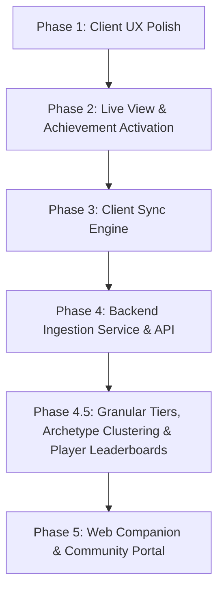

# Rhystic Cloud & Platform Vision & Roadmap

This document outlines the architectural strategy, vision, and roadmap for evolving Rhystic Tracker from a local-first desktop tracker into an open, community-driven analytics platform with an optional opt-in central server (inspired by platforms like Untapped.gg and 17lands).

---

## 1. Legal, Licensing & Values

- **License:** Licensed under the [MIT License](file:///home/matt/Code/Rhystic-Tracker-1.7.8/LICENSE). Anyone may fork, modify, rename, distribute, and build on the codebase provided the original MIT copyright notice is preserved.
- **WotC Fan Content Policy:** Strictly compliant. All tools and analytics are free forever. Optional donations / patronage cover server hosting and infrastructure costs with zero mandatory feature paywalls.
- **Privacy-First & Zero Telemetry by Default:** The application remains 100% operational offline. Communication with central servers is strictly opt-in.

---

## 2. Product Vision & Opportunities

### A. The "17lands for Brawl & Commander" (Rhystic's Niche)
While Untapped and 17lands focus heavily on 60-card Standard or Limited draft picks, Rhystic Tracker already houses the deepest Brawl and Commander combat engine in existence:
- **Commander Tier Lists & Salt Index:** Win rates, average turn counts, scoop frequency, and play rates for every commander on Arena.
- **Card Performance Metrics:** Game-in-hand win rate (GIH WR), cast frequency, and combat efficiency.
- **Micro-Combat Telemetry:**
  - *Deadliest Finishers:* Cards dealing the most lethal combat damage.
  - *Counterspell Impact:* Win-rate correlations when countering high-CMC spells.
  - *Titles:* Community stats for badges like "Scoop Inducer", "Royal Assassin", and "Negator".

### B. Global Meta Analytics & Matchup Matrix
- Aggregated archetype win rates across Standard, Historic, Timeless, Brawl, and Draft.
- Head-to-head matchup matrices (e.g. Dimir Midrange vs. Mono-Red on the play vs. on the draw).
- Deck building wildcard cost calculations integrated with user's uploaded collection.

### C. Web Companion & Social Sharing
- **Mobile/iPad Companion:** View match history, decks, and real-time live matches from Safari on an iPad or phone on your desk.
- **Shareable Match Timelines:** Direct web links displaying the visual turn-by-turn combat replay.

---

## 3. Core Architecture Rethink

### A. Live Match HUD vs. Live Deck Tracker UX
- **The Problem:** Two separate sidebar tabs created competition over auto-switching during match start and split the player's focus during games.
- **The Fix:**
  - Introduce an **On Match Start Auto-Switch** selector: `Off` | `Live Match HUD` | `Live Deck Tracker` | `HUD + Deck Split`.
  - Provide an embedded split-view mode (or toggle) in the Live HUD so deck remaining probabilities and live game logs coexist naturally.

### B. Leaderboards: Local vs. Global Community
- **Local Scope (Offline):** Personal Hall of Fame for single-hit damage, lifetime damage, and spell records.
- **Global Scope (Server):** Global Commander tier lists, community highest combat strikes, and format trends.

### C. Achievements: Card & Deck Synergy + Global Rarity
- Activate the shelved Deck Achievements engine (`On a Roll`, `Comeback Kid`, `Gotta Go Fast`, `Iron Fortress`, `Marathon Master`, `Deck Dominance`).
- Calculate Steam-style global rarity percentages on achievement badges without leaking player identities.

### D. Multi-Tier & Granular Privacy Architecture
- **Tier 0 (Offline Default):** Zero network traffic to central servers.
- **Tier 1 (Anonymous Meta Contributor):** One-click opt-in using a locally generated UUID (`contributor_id`). Submits match outcomes, turn counts, format, and card performance anonymously (no screen names).
- **Tier 2 (Linked Companion Profile):** Optional private `sync_key` for cross-device synchronization (Desktop PC, Linux/Steam Deck, Web/iPad companion) and private collection wildcard calculations.
- **Tier 3 (Public Leaderboard & Hall of Fame Profile):** Opt-in public player handle (`display_name`, with `#12345` Arena discriminator stripped) and seasonal Constructed/Limited rank. Unlocks placement on **Global Player Leaderboards**, Community Hall of Fame records, and attributed top decklists.
- **Granular Per-Signal Toggles (User-Controlled Checkboxes):**
  1. `share_match_outcomes`: Format, Win/Loss, Turn count, Play/Draw, Duration.
  2. `share_card_telemetry`: Seen card `grp_id`s, combat/spell damage, cards drawn, and earned combat titles.
  3. `share_full_decklist`: Full submitted maindeck/sideboard `(grp_id, count)` list for archetype clustering and deck win rates.
  4. `share_player_identity`: Public display name and rank tier for Global Leaderboards & Hall of Fame attribution.
  5. `share_collection_private`: Private collection counts tied only to the user's `sync_key` for web/iPad "Missing Wildcards" calculations.

### E. Deck & Meta Archetype Clustering Engine (How Deck Winrates Work)
Because players tweak 3–10 flex slots even in established meta decks, Rhystic Cloud uses a 4-layer aggregation pipeline (combining the best of Untapped.gg and 17Lands):
1. **Layer 1 — Exact Deck Fingerprint (`deck_hash`):**
   - Normalizes cosmetic reprints to canonical card names/oracle IDs and collapses basic land printings (`Plains`, `Island`, `Swamp`, `Mountain`, `Forest`, `Wastes`), then hashes sorted `(card_id, quantity)` pairs. Identical 60-card lists share the exact same `deck_hash`.
2. **Layer 2 — Commander & Brawl Grouping (`commander_grp_id` + Core/Flex Split):**
   - Singleton 100-card decks group primarily by `commander_grp_id` (+ `companion_grp_id`). Within each Commander, cards appearing in $\ge 70\%$ of lists form the **Core Package**, while flex slots are ranked by **Inclusion Win-Rate Delta** and **Seen Win Rate**.
3. **Layer 3 — 60-Card Constructed Archetype Clustering (TF-IDF Weighted Jaccard):**
   - Strips basic lands, computes color identity (`WUBRG`), and weights non-land cards by specificity (synergy build-arounds carry higher weight than ubiquitous removal).
   - Decklists with weighted Jaccard similarity $\ge 0.65$ (~85% shared non-land core) cluster into a single **Meta Archetype** (e.g. *Izzet Spellementals*, *Dimir Reanimator*), reporting both the **Overall Archetype Win Rate** and the **Highest-Winrate 60-Card Variant (`deck_hash`)**.
4. **Layer 4 — Limited Analytics (`Draft` & `Sealed` — 17Lands Methodology):**
   - Groups Limited decks by **Format + Color Pair (`WU`, `BR`, `GWr`)** and evaluates cards via **GP WR** (Maindeck Win Rate), **Seen WR** (Game-in-Hand / Cast Win Rate), and **IWD** (Improvement When Drawn).

---

## 4. Implementation Roadmap

### Phase 1: Client UX Polish (Completed)
- [x] Upgrade the Auto-Switch on Match Start setting to a multi-option selector in `GeneralTab.tsx`, `SettingsView.tsx`, and `App.tsx`:
  - `Off`
  - `Live Match HUD`
  - `Live Deck Tracker`
- [x] Allow `live-deck` as a startup tab option in settings.

### Phase 2: Live View, Commander Format Support & Deck Achievement Activation (Completed)
- [x] Activate the shelved deck achievements in [`deck_achievements.rs`](file:///home/matt/Code/Rhystic-Tracker-1.7.8/src-tauri/src/deck_achievements.rs) and [`main.rs`](file:///home/matt/Code/Rhystic-Tracker-1.7.8/src-tauri/src/main.rs), with starting-life-relative scaling for 20-life, 25-life Brawl, and 40-life Commander formats, plus automatic startup backfill from match history.
- [x] Wire the **Card Trophies | Deck Honors** category switcher and interactive deck honors grid into [`AchievementsView.tsx`](file:///home/matt/Code/Rhystic-Tracker-1.7.8/src/components/AchievementsView.tsx).
- [x] Promote `Commander` and `Commander - Competitive` to first-class formats in [`parser.rs`](file:///home/matt/Code/Rhystic-Tracker-1.7.8/src-tauri/src/parser.rs), [`App.tsx`](file:///home/matt/Code/Rhystic-Tracker-1.7.8/src/App.tsx), and [`FormatDistributionWidget.tsx`](file:///home/matt/Code/Rhystic-Tracker-1.7.8/src/components/dashboard/widgets/FormatDistributionWidget.tsx).
- [x] Persist the embedded Deck Tracker split-panel toggle (`liveHudDeckSplit`) inside [`LiveHUDView.tsx`](file:///home/matt/Code/Rhystic-Tracker-1.7.8/src/components/LiveHUDView.tsx).

### Phase 3: Client Sync Engine (`src-tauri/src/sync.rs`) (Completed)
- [x] Create an opt-in settings panel under [`ConnectionTab.tsx`](file:///home/matt/Code/Rhystic-Tracker-1.7.8/src/components/settings/ConnectionTab.tsx) (`SettingsView -> MTGA Connection / Community Sync`).
- [x] Design the anonymized match payload schema (`AnonymizedMatchPayload`: format, turn count, starting/ending/min life, commander & companion `grp_id`s, seen card `grp_id`s, and micro-combat stats with zero personal names or raw match IDs) in [`sync.rs`](file:///home/matt/Code/Rhystic-Tracker-1.7.8/src-tauri/src/sync.rs).
- [x] Build an asynchronous local outbox queue in SQLite (`sync_outbox` in [`db.rs`](file:///home/matt/Code/Rhystic-Tracker-1.7.8/src-tauri/src/db.rs)) wired to `MatchCompleted` and historical backfill via [`system.rs`](file:///home/matt/Code/Rhystic-Tracker-1.7.8/src-tauri/src/commands/system.rs).

### Phase 4: Server Ingestion & Analytical Database (`server/`) (Completed)
- [x] Develop a lightweight Rust (`axum`) ingestion API in [`server/src/lib.rs`](file:///home/matt/Code/Rhystic-Tracker-1.7.8/server/src/lib.rs) and [`server/src/main.rs`](file:///home/matt/Code/Rhystic-Tracker-1.7.8/server/src/main.rs), plus the HTTP outbox dispatcher (`flush_outbox_batch`) in [`src-tauri/src/sync.rs`](file:///home/matt/Code/Rhystic-Tracker-1.7.8/src-tauri/src/sync.rs).
- [x] Setup the analytical storage layer in [`server/src/db.rs`](file:///home/matt/Code/Rhystic-Tracker-1.7.8/server/src/db.rs) (`ingested_matches`, `ingested_match_cards`, `ingested_impactful_cards` with idempotent `match_hash` deduplication and composite indexes) covering all MTGA Constructed, Commander/Brawl, and Limited formats (excluding Alchemy).
- [x] Implement public REST endpoints for format meta (`/api/v1/meta/formats`), Commander & Brawl tier lists + Salt Index (`/api/v1/meta/commanders`), card seen win rates & micro-combat stats (`/api/v1/meta/cards`), and head-to-head Commander matchups (`/api/v1/meta/matchups`).

### Phase 4.5: Granular Data-Sharing Tiers, Archetype Clustering & Global Leaderboards
- [ ] Expand `SyncConfig` and [`ConnectionTab.tsx`](file:///home/matt/Code/Rhystic-Tracker-1.7.8/src/components/settings/ConnectionTab.tsx) with granular opt-in checkboxes (`share_card_telemetry`, `share_full_decklist`, `share_player_identity` with custom/sanitized display handle).
- [ ] Add `deck_hash`, `color_identity`, `archetype_tag`, `deck_cards` (maindeck `grp_id` quantities), and optional `player_display_name` + `rank_tier` to `AnonymizedMatchPayload` and [`server/src/db.rs`](file:///home/matt/Code/Rhystic-Tracker-1.7.8/server/src/db.rs).
- [ ] Implement Constructed Archetype & Decklist clustering (`GET /api/v1/meta/decks`) and Global Player / Hall of Fame Leaderboards (`GET /api/v1/leaderboards/players`, `GET /api/v1/leaderboards/records`).

### Phase 5: Web Companion & Community Portal (`web/` or served by `server/`)
- [ ] Build a responsive web portal matching the local Rhystic Tracker dark glassmorphic aesthetic (Mana themes, Keyrune/Mana-font icons, Scryfall card art backdrops) for browsing Global Meta Tier Lists, Archetype Decklists, Card Win Rates, Global Player Leaderboards, and iPad Companion views.

