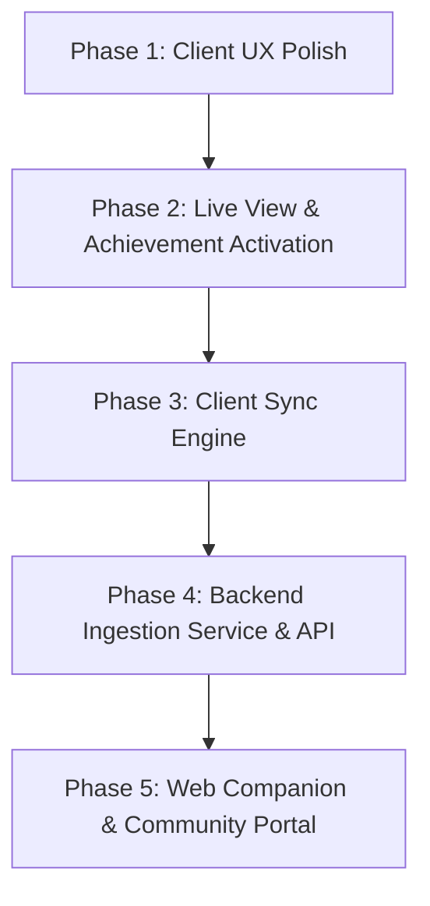

# Rhystic Cloud & Platform Vision & Roadmap

This document outlines the architectural strategy, vision, and roadmap for evolving Rhystic Tracker from a local-first desktop tracker into an open, community-driven analytics platform with an optional opt-in central server (inspired by platforms like Untapped.gg and 17lands).

---

## 1. Legal, Licensing & Values

- **License:** Licensed under the [MIT License](file:///home/matt/Code/Rhystic-Tracker-1.7.8/LICENSE). Anyone may fork, modify, rename, distribute, and build on the codebase provided the original MIT copyright notice is preserved.
- **WotC Fan Content Policy:** Strictly compliant. All tools and analytics are free forever. Optional donations / patronage cover server hosting and infrastructure costs with zero mandatory feature paywalls.
- **Privacy-First & Zero Telemetry by Default:** The application remains 100% operational offline. Communication with central servers is strictly opt-in.

---

## 2. Product Vision & Opportunities

### A. The "17lands for Brawl & Commander" (Rhystic's Niche)
While Untapped and 17lands focus heavily on 60-card Standard or Limited draft picks, Rhystic Tracker already houses the deepest Brawl and Commander combat engine in existence:
- **Commander Tier Lists & Salt Index:** Win rates, average turn counts, scoop frequency, and play rates for every commander on Arena.
- **Card Performance Metrics:** Game-in-hand win rate (GIH WR), cast frequency, and combat efficiency.
- **Micro-Combat Telemetry:**
  - *Deadliest Finishers:* Cards dealing the most lethal combat damage.
  - *Counterspell Impact:* Win-rate correlations when countering high-CMC spells.
  - *Titles:* Community stats for badges like "Scoop Inducer", "Royal Assassin", and "Negator".

### B. Global Meta Analytics & Matchup Matrix
- Aggregated archetype win rates across Standard, Historic, Timeless, Brawl, and Draft.
- Head-to-head matchup matrices (e.g. Dimir Midrange vs. Mono-Red on the play vs. on the draw).
- Deck building wildcard cost calculations integrated with user's uploaded collection.

### C. Web Companion & Social Sharing
- **Mobile/iPad Companion:** View match history, decks, and real-time live matches from Safari on an iPad or phone on your desk.
- **Shareable Match Timelines:** Direct web links displaying the visual turn-by-turn combat replay.

---

## 3. Core Architecture Rethink

### A. Live Match HUD vs. Live Deck Tracker UX
- **The Problem:** Two separate sidebar tabs created competition over auto-switching during match start and split the player's focus during games.
- **The Fix:**
  - Introduce an **On Match Start Auto-Switch** selector: `Off` | `Live Match HUD` | `Live Deck Tracker` | `HUD + Deck Split`.
  - Provide an embedded split-view mode (or toggle) in the Live HUD so deck remaining probabilities and live game logs coexist naturally.

### B. Leaderboards: Local vs. Global Community
- **Local Scope (Offline):** Personal Hall of Fame for single-hit damage, lifetime damage, and spell records.
- **Global Scope (Server):** Global Commander tier lists, community highest combat strikes, and format trends.

### C. Achievements: Card & Deck Synergy + Global Rarity
- Activate the shelved Deck Achievements engine (`On a Roll`, `Comeback Kid`, `Gotta Go Fast`, `Iron Fortress`, `Marathon Master`, `Deck Dominance`).
- Calculate Steam-style global rarity percentages on achievement badges without leaking player identities.

### D. Multi-Tier Privacy Architecture
- **Tier 0 (Offline Default):** No network traffic to central servers.
- **Tier 1 (Anonymous Contributor):** One-click opt-in using a locally generated UUID. Submits match results, turn counts, format, and card performance anonymously (no screen names). Unlocks global meta viewing.
- **Tier 2 (Linked Profile):** Optional sync key for cross-device synchronization (PC, Steam Deck, Web/iPad companion).

---

## 4. Implementation Roadmap

### Phase 1: Client UX Polish (Completed)
- [x] Upgrade the Auto-Switch on Match Start setting to a multi-option selector in `GeneralTab.tsx`, `SettingsView.tsx`, and `App.tsx`:
  - `Off`
  - `Live Match HUD`
  - `Live Deck Tracker`
- [x] Allow `live-deck` as a startup tab option in settings.

### Phase 2: Live View, Commander Format Support & Deck Achievement Activation (Completed)
- [x] Activate the shelved deck achievements in [`deck_achievements.rs`](file:///home/matt/Code/Rhystic-Tracker-1.7.8/src-tauri/src/deck_achievements.rs) and [`main.rs`](file:///home/matt/Code/Rhystic-Tracker-1.7.8/src-tauri/src/main.rs), with starting-life-relative scaling for 20-life, 25-life Brawl, and 40-life Commander formats, plus automatic startup backfill from match history.
- [x] Wire the **Card Trophies | Deck Honors** category switcher and interactive deck honors grid into [`AchievementsView.tsx`](file:///home/matt/Code/Rhystic-Tracker-1.7.8/src/components/AchievementsView.tsx).
- [x] Promote `Commander` and `Commander - Competitive` to first-class formats in [`parser.rs`](file:///home/matt/Code/Rhystic-Tracker-1.7.8/src-tauri/src/parser.rs), [`App.tsx`](file:///home/matt/Code/Rhystic-Tracker-1.7.8/src/App.tsx), and [`FormatDistributionWidget.tsx`](file:///home/matt/Code/Rhystic-Tracker-1.7.8/src/components/dashboard/widgets/FormatDistributionWidget.tsx).
- [x] Persist the embedded Deck Tracker split-panel toggle (`liveHudDeckSplit`) inside [`LiveHUDView.tsx`](file:///home/matt/Code/Rhystic-Tracker-1.7.8/src/components/LiveHUDView.tsx).

### Phase 3: Client Sync Engine (`src-tauri/src/sync.rs`) (Completed)
- [x] Create an opt-in settings panel under [`ConnectionTab.tsx`](file:///home/matt/Code/Rhystic-Tracker-1.7.8/src/components/settings/ConnectionTab.tsx) (`SettingsView -> MTGA Connection / Community Sync`).
- [x] Design the anonymized match payload schema (`AnonymizedMatchPayload`: format, turn count, starting/ending/min life, commander & companion `grp_id`s, seen card `grp_id`s, and micro-combat stats with zero personal names or raw match IDs) in [`sync.rs`](file:///home/matt/Code/Rhystic-Tracker-1.7.8/src-tauri/src/sync.rs).
- [x] Build an asynchronous local outbox queue in SQLite (`sync_outbox` in [`db.rs`](file:///home/matt/Code/Rhystic-Tracker-1.7.8/src-tauri/src/db.rs)) wired to `MatchCompleted` and historical backfill via [`system.rs`](file:///home/matt/Code/Rhystic-Tracker-1.7.8/src-tauri/src/commands/system.rs).

### Phase 4: Server Ingestion & Analytical Database (`server/`)
- [ ] Develop a lightweight ingestion API using Rust (`axum`) or Go.
- [ ] Setup an analytical storage layer (ClickHouse / TimescaleDB / PostgreSQL) optimized for aggregations over millions of match events.
- [ ] Implement public REST/GraphQL endpoints for meta tier lists and card win rates.

### Phase 5: Web Companion & Community Portal
- [ ] Build a responsive web interface (Next.js / Astro) for global meta browsing, deck exploration, and iPad companion views.

